<a name="top"></a>

<!-- ═════════════════ HERO (animated SVG) ═════════════════ -->
<div align="center">


<!-- NAVBAR -->
<p>
<a href="#about"></a>
<a href="#skills"></a>
<a href="#exploring"></a>
<a href="#projects"></a>
<a href="#stats"></a>
<a href="#roadmap"></a>
<a href="#contact"></a>
</p>

<!-- CTA -->
<a href="https://saifullah857.github.io/saif-ullah-portfolio/"></a>
<a href="mailto:ranasaifullahkhalid2@gmail.com"></a>
<a href="https://www.linkedin.com/in/saif-ullah-khalid-412221379/"></a>
<a href="https://github.com/saifullah857"></a>

<br/>

[](https://github.com/saifullah857)
[](https://github.com/saifullah857?tab=followers)
[](https://github.com/saifullah857?tab=repositories)

</div>

<!-- ═════════════════ ABOUT ═════════════════ -->
<a name="about"></a>

<table>
<tr>
<td width="34%" align="center" valign="top">


<br/><br/>

**Saif Ullah**
<br/>
AI/ML Engineer · Agentic Systems · Full-Stack
<br/>
📍 Pakistan 🇵🇰
<br/>
📧 ranasaifullahkhalid2@gmail.com

</td>
<td width="66%">

```python
class SaifUllah:
    def __init__(self):
        self.name     = "Saif Ullah"
        self.role     = ["AI/ML Engineer",
                         "Agentic Systems Builder",
                         "Full-Stack Developer"]
        self.location = "Pakistan 🇵🇰"

    @property
    def current_work(self):
        return {
            "🎤 Career AI"  : "InterviewPilot AI — interview prep for software-house roles",
            "🏦 FinTech AI" : "AegisBank AI — fraud investigation, 6-agent LangGraph pipeline",
            "💼 Resume AI"  : "LinkedIn AI Analyzer — 9 Agno + Groq agents",
            "📊 AutoML"     : "AI Data Scientist Agent — CSV → trained & explained model",
            "💊 Health AI"  : "Medical RAG Chatbot — LangChain + ChromaDB + Groq",
        }

    @property
    def stack(self):
        return {
            "AI/ML"     : ["PyTorch", "TensorFlow", "HuggingFace",
                           "LangChain", "LangGraph", "Agno", "Phidata",
                           "OpenCV", "Gemini", "FAISS", "ChromaDB"],
            "LLMOps"    : ["RAG Evaluation", "LLM Evals", "Guardrails",
                           "LLM Gateways", "Prompt Testing"],
            "Backend"   : ["FastAPI", "Flask", "Node.js", "Laravel", "Express"],
            "Frontend"  : ["React.js", "Tailwind CSS", "Bootstrap"],
            "DevOps"    : ["Docker", "GitHub Actions (CI/CD)", "Git", "Linux"],
            "Databases" : ["MongoDB", "MySQL", "ChromaDB", "FAISS"],
        }

    def motto(self):
        return "Build smart. Ship fast. Scale gracefully. 🚀"
```

</td>
</tr>
</table>

<div align="center">

| | | |
|:---:|:---|:---|
| 🔭 | **Working On** | InterviewPilot AI · AegisBank AI · LinkedIn AI Analyzer · AI Data Scientist Agent |
| 🌱 | **Learning** | LLM Fine-tuning (PEFT/LoRA) · LangGraph Multi-Agent Systems · LLM & RAG Evaluation · Docker · CI/CD · MLOps |
| 👯 | **Collaborate** | AI/ML Projects · Agentic Apps · Full-Stack Products · Open Source |
| 💬 | **Ask Me About** | LangGraph · LangChain · Agno · RAG · PyTorch · React · Laravel · Reinforcement Learning |
| 🎯 | **2026 Goals** | AI Engineering Role · Production-grade Agent Systems · OSS Contributions |
| ⚡ | **Fun Fact** | I debug neural nets & React apps at the same time — both work. |

</div>

<!-- ═════════════════ SKILLS ═════════════════ -->
<a name="skills"></a>

<div align="center">

**🤖 AI, Agents & Frameworks**


<br/>

**🧪 Domains & LLMOps**


<br/>

**🌐 Full-Stack**


<br/>

**🛠️ DevOps, Databases & Tools**


<br/>

**💬 Languages**


<br/><br/>


</div>

<!-- ═════════════════ EXPLORING ═════════════════ -->
<a name="exploring"></a>

<div align="center">


</div>

```mermaid
%%{init: {'theme':'dark','themeVariables':{'primaryColor':'#3a1620','primaryBorderColor':'#8c1c33','primaryTextColor':'#f5e9eb','lineColor':'#e8b4a0','fontFamily':'sans-serif'}}}%%
flowchart LR
    A[📄 Data / Docs] --> B[🔎 Chunk + Embed<br/>ChromaDB · FAISS]
    B --> C[🕸️ LangGraph Agents]
    C --> D[🛡️ Guardrails]
    D --> E[🧪 LLM / RAG Evals]
    E --> F[🐳 Docker]
    F --> G[⚙️ GitHub Actions CI/CD]
    G --> H[🚀 FastAPI Deployment]
    style C fill:#8c1c33,color:#fff
    style E fill:#8c1c33,color:#fff
    style G fill:#8c1c33,color:#fff
```

<!-- ═════════════════ PROJECTS ═════════════════ -->
<a name="projects"></a>

### 🔥 Latest & Flagship

<div align="center">
<table>
<tr>
<td width="50%" valign="top" align="center">
<a href="https://github.com/saifullah857/interviewpilot-ai"></a>
<br/><sub>Resume analysis, AI-driven role matching and interview practice for students, fresh graduates and junior developers.</sub>
<br/><br/>
</td>
<td width="50%" valign="top" align="center">
<a href="https://github.com/saifullah857/aegisbank-ai"></a>
<br/><sub>Rule-based risk scoring, Isolation Forest anomaly detection, a six-agent LangGraph pipeline, RAG policy retrieval and human-in-the-loop review.</sub>
<br/><br/>
</td>
</tr>
<tr>
<td width="50%" valign="top" align="center">
<a href="https://github.com/saifullah857/linkedin-ai-analyzer"></a>
<br/><sub>Nine specialised agents: ATS scoring, recruiter verdict, keyword gaps and a prioritised career roadmap. ⭐ 3</sub>
<br/><br/>
</td>
<td width="50%" valign="top" align="center">
<a href="https://github.com/saifullah857/ai-data-scientist-agent"></a>
<br/><sub>Bring your own Groq key: an Agno agent orchestrates a deterministic scikit-learn pipeline.</sub>
<br/><br/>
</td>
</tr>
</table>
</div>


### 🤖 AI Agents & LLM Applications

<div align="center">
<table>
<tr>
<td width="50%" valign="top" align="center">
<a href="https://github.com/saifullah857/medical-rag-chatbot"></a>
<br/><sub>Medical Q&A with retrieval-augmented generation (LangChain, ChromaDB, Groq qwen3-32b). ⭐ 2</sub>
<br/><br/>
</td>
<td width="50%" valign="top" align="center">
<a href="https://github.com/saifullah857/chat-with-docs"></a>
<br/><sub>RAG chatbot to ask questions across your own documents with LangChain, FAISS and Groq.</sub>
<br/><br/>
</td>
</tr>
<tr>
<td width="50%" valign="top" align="center">
<a href="https://github.com/saifullah857/edufees-ai"></a>
<br/><sub>College and university fees management with Agno, Groq LLaMA 3.3, Gemini 2.0, Flask and Excel.</sub>
<br/><br/>
</td>
<td width="50%" valign="top" align="center">
<a href="https://github.com/saifullah857/assistent-cicd-learning"></a>
<br/><sub>Flask AI assistant (Agno + Groq) used to practise CI/CD with GitHub Actions.</sub>
<br/><br/>
</td>
</tr>
<tr>
<td width="50%" valign="top" align="center">
<a href="https://github.com/saifullah857/Intelligent-PDF-question-answering-system-with-LangChain-"></a>
<br/><sub>Loads, chunks, embeds and stores PDFs in a persistent vector DB with Sentence Transformers.</sub>
<br/><br/>
</td>
<td width="50%" valign="top" align="center">
<a href="https://github.com/saifullah857/Add-Generator-Agent"></a>
<br/><sub>An AI agent that generates targeted ad copy for any business.</sub>
<br/><br/>
</td>
</tr>
<tr>
<td width="50%" valign="top" align="center">
<a href="https://github.com/saifullah857/Aria-Assistant"></a>
<br/><sub>Ask questions, summarise emails and extract action items and deadlines.</sub>
<br/><br/>
</td>
<td width="50%" valign="top" align="center">
<a href="https://github.com/saifullah857/youtube_analyzer-agent"></a>
<br/><sub>Transcribes YouTube videos, summarises them and extracts insights.</sub>
<br/><br/>
</td>
</tr>
</table>
</div>


### 🧠 Deep Learning, NLP & Computer Vision

<div align="center">
<table>
<tr>
<td width="50%" valign="top" align="center">
<a href="https://github.com/saifullah857/ai-neural-style-transfer"></a>
<br/><sub>Turn any photo into a stylish AI-painted image with PyTorch + Flask.</sub>
<br/><br/>
</td>
<td width="50%" valign="top" align="center">
<a href="https://github.com/saifullah857/Transformer-T5-Dialogue-Summarizer"></a>
<br/><sub>Abstractive dialogue summarisation, from training to local FastAPI inference.</sub>
<br/><br/>
</td>
</tr>
<tr>
<td width="50%" valign="top" align="center">
<a href="https://github.com/saifullah857/AI-Based-Atendence-System"></a>
<br/><sub>Automates student attendance with face and voice recognition.</sub>
<br/><br/>
</td>
<td width="50%" valign="top" align="center">
<a href="https://github.com/saifullah857/Pytorch-Cifar10-Classifier-project-code"></a>
<br/><sub>CNN from scratch with training loops, accuracy tracking and evaluation. ⭐ 1</sub>
<br/><br/>
</td>
</tr>
<tr>
<td width="50%" valign="top" align="center">
<a href="https://github.com/saifullah857/RNN-for-Sentiments-Analysis-Project"></a>
<br/><sub>Sentiment classification with LSTM layers on real review datasets.</sub>
<br/><br/>
</td>
<td width="50%"></td>
</tr>
</table>
</div>


### 🎮 Reinforcement Learning

<div align="center">
<table>
<tr>
<td width="50%" valign="top" align="center">
<a href="https://github.com/saifullah857/Flappy-Bird-Game-Trained-With-DQN"></a>
<br/><sub>An agent that learns Flappy Bird purely through trial, reward and punishment.</sub>
<br/><br/>
</td>
<td width="50%" valign="top" align="center">
<a href="https://github.com/saifullah857/SARSA-Reinforcement-Learning-Agent-for-Cliff-Walking-Environment"></a>
<br/><sub>Benchmarked against Q-Learning with policy visualisation and reward curves. ⭐ 1</sub>
<br/><br/>
</td>
</tr>
</table>
</div>


### 📊 Machine Learning & Data Science

<div align="center">
<table>
<tr>
<td width="50%" valign="top" align="center">
<a href="https://github.com/saifullah857/CreditWise-Loan-Approval-System-with-dashboard"></a>
<br/><sub>Loan approval model with an interactive dashboard for real-time inference. ⭐ 1</sub>
<br/><br/>
</td>
<td width="50%" valign="top" align="center">
<a href="https://github.com/saifullah857/Smartcart-Clustering-System"></a>
<br/><sub>Customer segmentation with K-Means for smart retail recommendations. ⭐ 1</sub>
<br/><br/>
</td>
</tr>
</table>
</div>

<details>
<summary><b>More ML repositories</b> — click to expand</summary>
<br/>

| Project | Description |
|:---|:---|
| 🧠 [Mental Health Score Predictor](https://github.com/saifullah857/Mental-Health-Score-Predictor) | ML model predicting mental health scores |
| 🔍 [Anomaly Detection Lab](https://github.com/saifullah857/-Unsupervised-Learning-Anomaly-Detection) | K-Means, DBSCAN, hierarchical clustering, PCA, outliers |
| 📚 [Supervised Learning Lab](https://github.com/saifullah857/Supervised-Learning-Lab) | Classification, regression, cross-validation |
| 🔬 [Applied ML Lab](https://github.com/saifullah857/Applied-Machine-Learning-Lab) ⭐ | End-to-end ML pipelines |
| 🤖 [50 ML Projects](https://github.com/saifullah857/50-Machine-Learning-Projects) | Growing collection of 50 hands-on ML projects |

</details>

### 🌐 Full-Stack & Web Applications

<div align="center">
<table>
<tr>
<td width="50%" valign="top" align="center">
<a href="https://github.com/saifullah857/hotel-booking-web-application"></a>
<br/><sub>Listings, bookings, gallery, admin dashboard and email notifications.</sub>
<br/><br/>
</td>
<td width="50%" valign="top" align="center">
<a href="https://github.com/saifullah857/Wonderlust-Website-Room-Booking-Website-MERN-Stack"></a>
<br/><sub>Scalable REST API with JWT auth, role-based authorization, MongoDB and MVC.</sub>
<br/><br/>
</td>
</tr>
<tr>
<td width="50%" valign="top" align="center">
<a href="https://github.com/saifullah857/-Saifi-Coder-E-Learning-Platform"></a>
<br/><sub>Students enrol, instructors manage content, admins control everything. ⭐ 1</sub>
<br/><br/>
</td>
<td width="50%"></td>
</tr>
</table>
</div>

<details>
<summary><b>More web repositories</b> — click to expand</summary>
<br/>

| Project | Stack |
|:---|:---|
| ⚡ [Express.js Practice Projects](https://github.com/saifullah857/ExpressJS-Full-Stack-Practice-Projects) | REST APIs · Auth · MongoDB |
| 🐍 [Flask Web Fundamentals](https://github.com/saifullah857/flask-web-fundamentals) | Routing · Jinja2 · REST JSON API |
| 🕸️ [Web Scraping & API Lab](https://github.com/saifullah857/Python-Web-Scraping-Api-Lab) | requests · BeautifulSoup4 · pandas |
| 🌍 [Portfolio Website](https://github.com/saifullah857/saif-ullah-portfolio) | AI/ML Engineer portfolio (HTML) |

</details>

### 📚 Learning Resources & Cheatsheets

<div align="center">
<table>
<tr>
<td width="50%" valign="top" align="center">
<a href="https://github.com/saifullah857/GenAI-Agentic-Mastery"></a>
<br/><sub>LangChain, LangGraph, RAG, deep agents, guardrails, LLM evaluation and gateways.</sub>
<br/><br/>
</td>
<td width="50%"></td>
</tr>
</table>
</div>

<details>
<summary><b>More learning repositories</b> — click to expand</summary>
<br/>

| Resource | What's inside |
|:---|:---|
| 🤖 [Phidata Agent MasterGuide](https://github.com/saifullah857/phidata-agent-masterguide) | Agents → multi-agent teams → FastAPI + Docker deployment |
| 🐍 [Python with Saif](https://github.com/saifullah857/python-with-saif) | Daily lectures, notes, slides & assignments |
| 🔢 [NumPy Mastery](https://github.com/saifullah857/numpy-mastery) | 55x faster than Python lists, with benchmarks |
| 🗄️ [MySQL for AI/ML](https://github.com/saifullah857/mysql-for-ai-ml) · [Cheatsheet](https://github.com/saifullah857/MySQL-Cheatsheet) | CRUD → feature engineering → ML pipelines |
| 📊 [Streamlit Cheatsheet](https://github.com/saifullah857/streamlit-cheatsheet) | Developer-friendly reference |
| 🤖 [Gemini AI Learner](https://github.com/saifullah857/gemini-ai-learner) | Text, image, video generation with Gemini |
| 📉 [Matplotlib & Seaborn](https://github.com/saifullah857/matplotlib-seaborn-visualization) · 🐼 [Pandas Lab](https://github.com/saifullah857/pandas-data-lab) | Visualization & data wrangling |
| 🎨 [Bootstrap Practice Kit](https://github.com/saifullah857/bootstrap-practice-kit) | 34 Bootstrap 5.3 examples |
| 🧩 [NeetCode Submissions](https://github.com/saifullah857/neetcode-submissions) | DSA practice in Python |

</details>

<!-- ═════════════════ STATS ═════════════════ -->
<a name="stats"></a>

<div align="center">


<br/>


<br/>


<br/>


</div>

<!-- ═════════════════ ROADMAP ═════════════════ -->
<a name="roadmap"></a>

<div align="center">

</div>

<!-- ═════════════════ CONTACT ═════════════════ -->
<a name="contact"></a>

<div align="center">

> 🚀 **Actively seeking** AI/ML Engineering, Agentic AI & Full-Stack Development roles

| 💼 Role | 🔍 Type | 📍 Location |
|:---|:---|:---|
| AI / ML Engineer | Full-time / Contract | Remote 🌍 |
| Agentic AI / LLM Developer | Full-time / Freelance | Remote 🌍 |
| Full-Stack Developer | Full-time / Freelance | Remote / Pakistan 🇵🇰 |
| AI Research Assistant | Part-time / Internship | Remote 🌍 |

<br/>

<a href="https://saifullah857.github.io/saif-ullah-portfolio/"></a>
<a href="mailto:ranasaifullahkhalid2@gmail.com"></a>
<a href="https://www.linkedin.com/in/saif-ullah-khalid-412221379/"></a>
<a href="https://github.com/saifullah857"></a>

<br/><br/>

<a href="#top"></a>

<br/>

*"Combining intelligent systems with practical software to solve real-world problems."*

**— Saif Ullah**

</div>


