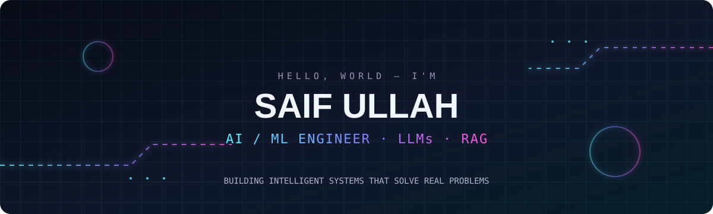

<div align="center">



<a href="https://readme-typing-svg.demolab.com">
  
</a>

<br/>

<a href="https://github.com/saifullah857"></a>
<a href="https://github.com/saifullah857?tab=repositories"></a>
<a href="https://www.linkedin.com/in/saif-ullah-khalid-412221379/"></a>

</div>

---

## `whoami`

I'm **Saif Ullah**, a Computer Science graduate focused on building practical AI applications. I'm especially interested in LLM-powered products, retrieval-augmented generation, AI agents, and making AI responses more reliable.

```python
profile = {
    "focus": ["AI/ML", "Generative AI", "LLMs", "RAG", "AI Agents"],
    "build_with": ["Python", "FastAPI", "Flask", "LangChain", "Agno"],
    "currently_exploring": [
        "RAG evaluation",
        "LLM security and guardrails",
        "Hallucination reduction",
        "Agentic workflows",
    ],
    "goal": "Build useful AI products that solve real problems",
}
```

## `01 / selected_builds`

<div align="center">
<table>
<tr>
<td width="50%" valign="top">

### ◈ Medical RAG Chatbot

A medical question-answering project built around retrieval-augmented generation.

**Stack:** Python · LangChain · ChromaDB · Groq

[](https://github.com/saifullah857/medical-rag-chatbot)

</td>
<td width="50%" valign="top">

### ◈ EduFees AI

An AI-powered fee-management project with an intelligent assistant workflow.

**Stack:** Python · Flask · Agno · LLM APIs

[](https://github.com/saifullah857/edufees-ai)

</td>
</tr>
<tr>
<td width="50%" valign="top">

### ◈ T5 Dialogue Summarizer

Transformer-based dialogue summarization using the T5 model and SAMSum dataset.

**Stack:** Python · PyTorch · Hugging Face · FastAPI

[](https://github.com/saifullah857/Transformer-T5-Dialogue-Summarizer)

</td>
<td width="50%" valign="top">

### ◈ ARIA AI Assistant

A personal assistant project for AI-powered question answering and text tasks.

**Stack:** Python · Flask · Gemini

[](https://github.com/saifullah857/Aria-Assistant)

</td>
</tr>
<tr>
<td width="50%" valign="top">

### ◈ Flappy Bird — DQN

A reinforcement-learning project where a Deep Q-Network agent learns to play through rewards and experience.

**Stack:** Python · Deep Q-Network · Reinforcement Learning

[](https://github.com/saifullah857/Flappy-Bird-Game-Trained-With-DQN)

</td>
<td width="50%" valign="top">

### ◈ Saifi-Coder E-Learning

A role-based e-learning platform built as a full-stack project.

**Stack:** Laravel · PHP · MySQL · Bootstrap

[](https://github.com/saifullah857/-Saifi-Coder-E-Learning-Platform)

</td>
</tr>
</table>
</div>

<p align="center">
  <a href="https://github.com/saifullah857?tab=repositories">
    
  </a>
</p>

## `02 / technical_stack`

<div align="center">

**AI · ML · LLMs**


**Web · Data · Tools**


</div>

## `03 / github_telemetry`

<div align="center">


<br/>


<br/>


</div>

## `04 / contribution_animation`

<div align="center">


</div>

## `05 / connect`

<div align="center">

<a href="https://www.linkedin.com/in/saif-ullah-khalid-412221379/"></a>
<a href="https://github.com/saifullah857"></a>
<a href="mailto:ranasaifullahkhalid2@gmail.com"></a>

<br/><br/>

**Building intelligent systems. Solving real problems. Learning every day.**



</div>
